<div align="center">

# ✅ To-Do Pro

**A free to-do app that syncs across your devices and reminds you even when the app is closed.**

[](https://abdurrahmancce.github.io/To-Do-Pro/)


📱 Phone · 💻 Laptop · 🖥️ PC &nbsp;|&nbsp; 📖 User guide (English and Bangla): `help.html` or **Account → Help** inside the app

</div>

---

## 📑 Contents

| | | |
|---|---|---|
| [🎬 Demo video](#-demo-video) | [🖼️ Screenshots](#️-screenshots) | [✨ Features](#-features) |
| [🚀 Get started](#-get-started) | [🏗️ How it works](#️-how-it-works) | [🔮 Future updates](#-future-updates) |
| [📦 Deploying updates](#-deploying-updates) | [🗂️ Repository layout](#️-repository-layout) | [👨‍💻 Contact developer](#-contact-developer) |

---

## 🎬 Demo video

A 4-minute guided tour of every feature, with captions that show where to click.

https://github.com/user-attachments/assets/cb3177fe-68b8-49ea-9f75-c5d787bb76d6

---

## 🖼️ Screenshots

<div align="center">

| Dashboard (dark) | Dashboard (light) |
|:---:|:---:|
| 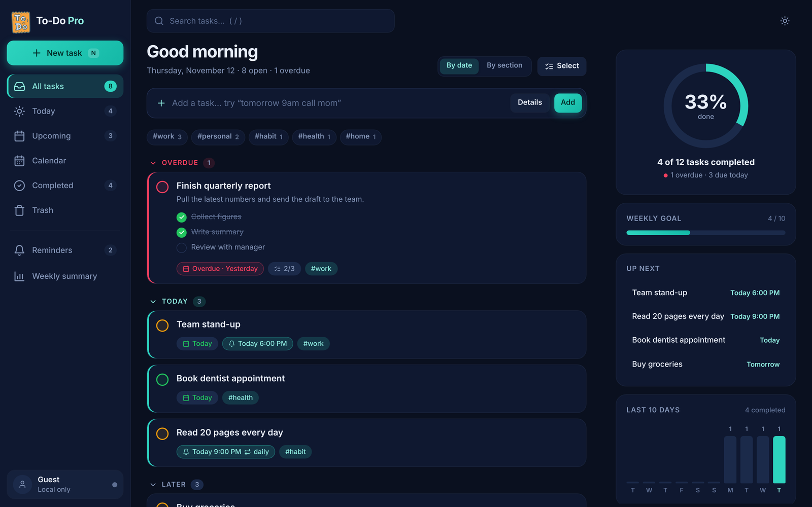 | 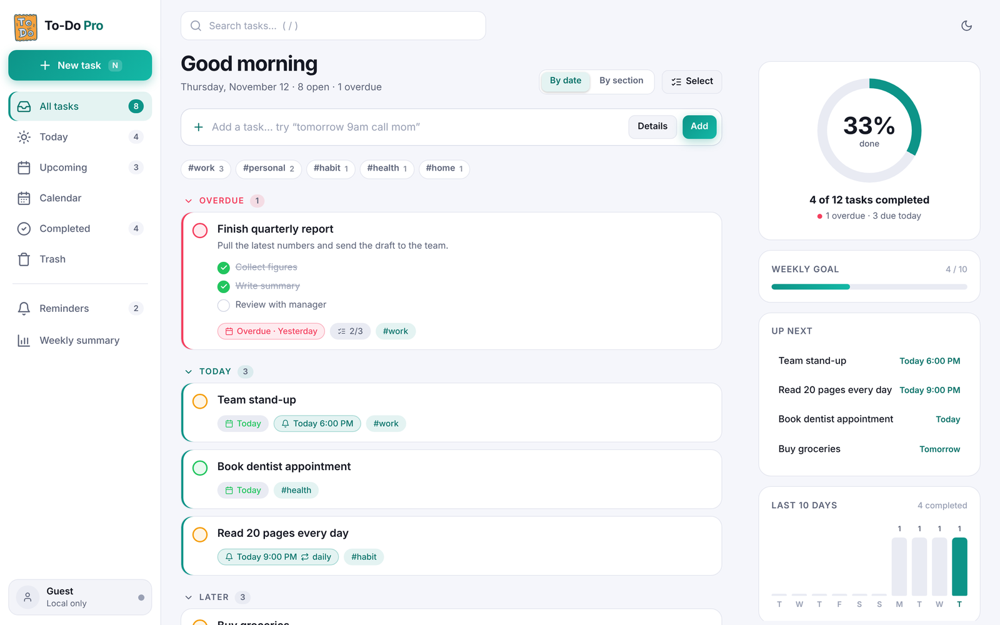 |
| Labelled sidebar, grouped tasks and a focus panel with progress, weekly goal and up next. | The same layout in the light theme. Theme and accent colour follow your account. |

| Task editor | Calendar |
|:---:|:---:|
| 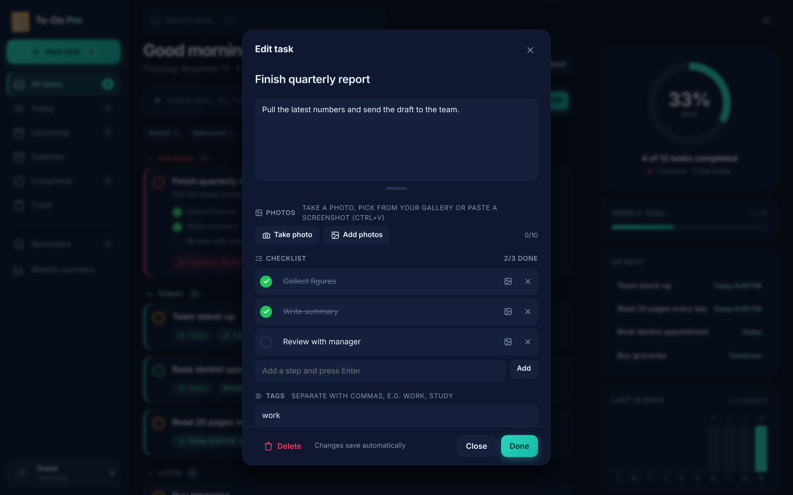 | 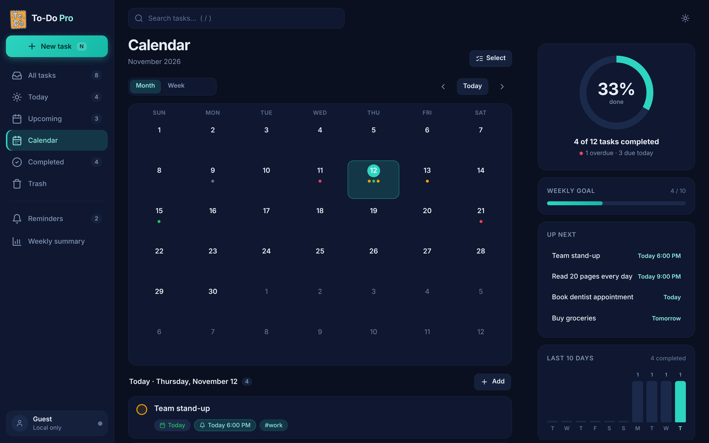 |
| Notes, photos, checklist, tags, due date and reminder, saved automatically. | See tasks by month and pick a day. |

| Phone (dark) | Phone (Today) | Phone (light) |
|:---:|:---:|:---:|
| 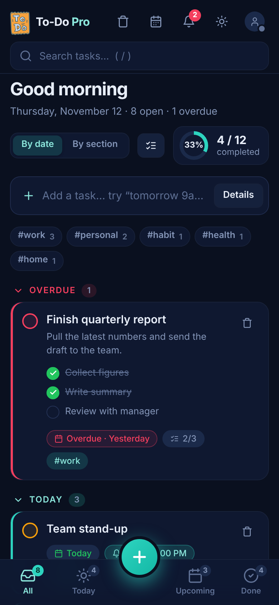 | 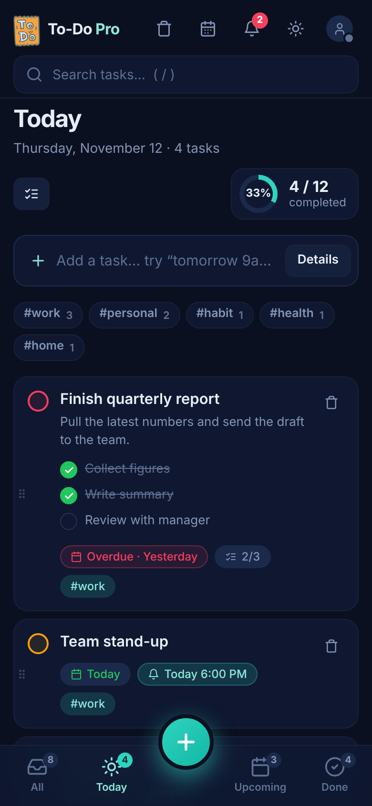 | 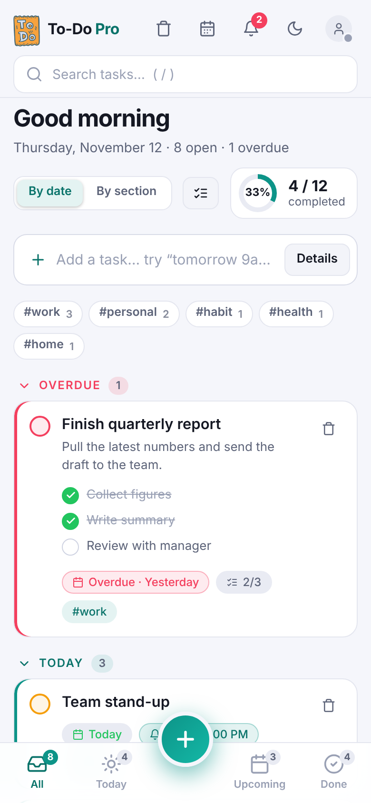 |

| Share sheet | Download options (phone) | Image export |
|:---:|:---:|:---:|
| 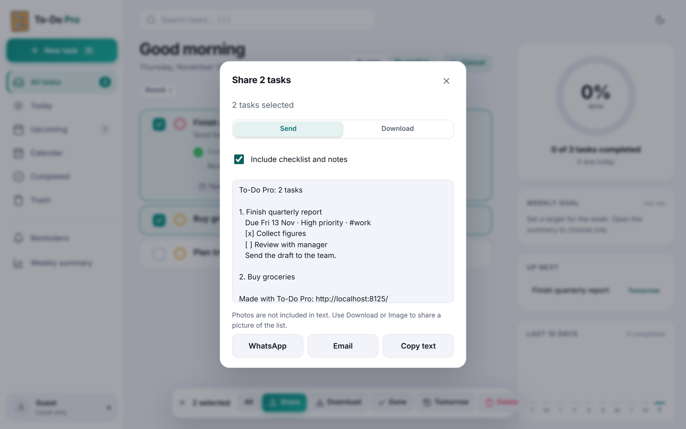 | 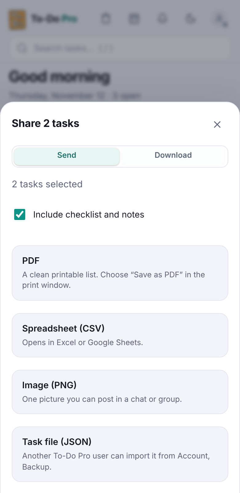 | 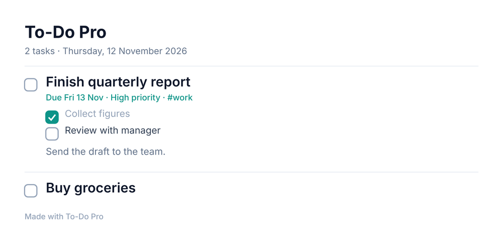 |
| Select tasks, then **Share**: send as text by WhatsApp, email, your phone's share sheet, or copy. | **Download** gives a PDF, CSV spreadsheet, PNG image or an importable task file. | The PNG is a clean picture of the list you can post in any chat. |

| First-time tour |
|:---:|
| 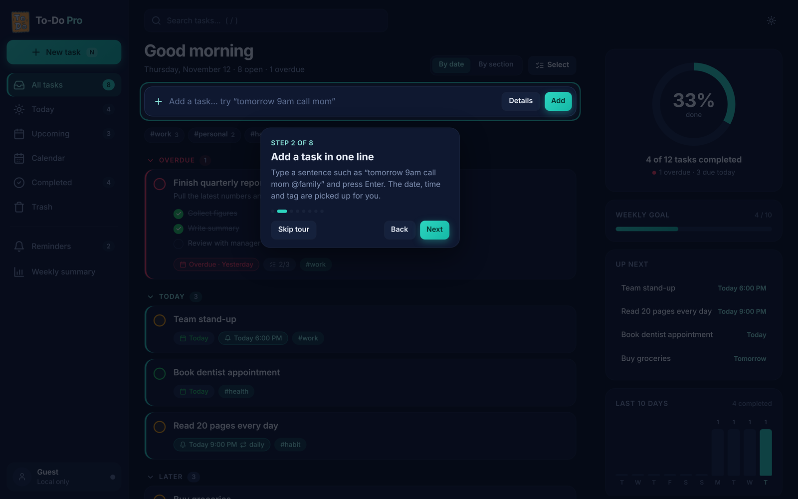 |
| A short guided tour for new users, replayable from **Account → Show tour**. |

</div>

> Screenshots use sample tasks.

---

## ✨ Features

### 📝 Tasks
- ⚡ **Smart quick add**: type `Call mom tomorrow 6pm !high @family` and the date, time, priority and tag are filled in for you. Common Bangla and Banglish time words are understood too.
- 🎯 Priorities (low, medium, high), due dates, sections, notes
- ✅ **Checklist (subtasks):** break a task into steps, tick each with a ✔ right from the task list, see progress like `3/4`. Paste a list to add one step per line. Up to 50 steps per task.
- 📷 **Photos:** attach pictures to a task or to a single checklist step. Use the camera, pick several from the gallery or paste a screenshot. Each picture can have a description, opens full screen and syncs across your devices. Pictures are shrunk on your phone before they are stored (up to 10 per task and 3 per step).
- 👥 **Friends and groups:** add friends with a private code or link, create groups and invite people (Account → Friends and groups). Sharing tasks with them is coming next.
- 🔁 Repeating tasks (daily, weekly) with 🔥 streak tracking
- 👀 Views: **All · Today · Upcoming · Calendar (month and week) · Completed · Trash · Reminders · Weekly summary**
- 🔎 Search, 👆 swipe actions, ↕️ drag to reorder, ☑️ bulk select (done, tomorrow, delete) with undo
- 📤 **Share and download selected tasks:** tap **Select**, pick tasks, then **Share** (WhatsApp, email, your phone's share sheet or copy) or **Download** (PDF, CSV spreadsheet, PNG image, importable task file). Checklist and notes are included if you want them.
- 🎬 **First-time tour:** a short guided walkthrough for new users, replayable from Account → Show tour.
- 📲 **Easy install and sharing:** Account → Get the app has an Install button, a QR code, Copy link and a WhatsApp invite.
- ⌨️ Shortcuts: `n` new task · `/` or `Ctrl+K` search · `Ctrl+Enter` save in the editor

### 🛡️ Your data stays safe
| Feature | What it does |
|---|---|
| 💾 **Autosave** | Every change is saved as you type, online or offline. Closing the editor or switching apps saves too. |
| ↩️ **Undo** | 5 seconds to undo any delete. |
| 🗑️ **Trash** | Deleted tasks stay 30 days. Restore, delete forever or empty the trash. Syncs across devices. |
| 📤 **Export / Import** | Back up tasks as JSON. Import is validated and size-limited. |

### 🔄 Accounts and sync
- 📧 Email and password: sign in, create account, reset password
- 🔑 Optional Google sign-in · 👤 optional guest mode (data stays on that device)
- ☁️ Firebase Firestore sync with offline cache. Edits made offline sync when you reconnect.
- 🎬 Animated login screen shown in English and Bangla side by side

### 🔔 Reminders
- 🔊 In-app alarm popup with sound (custom length), **Done** and **Snooze**
- 📲 **Background push** reminders when the app is closed (Firebase Cloud Messaging + Cloudflare Worker)
- ⏰ Optional **heads-up** reminder before the alarm
- 🔁 **Backup reminder** 90 seconds later if you have not responded
- 🎛️ **Done / Snooze buttons on the notification** itself
- 🔕 Handle a reminder on one device and the notification disappears on your other devices

### 📣 Updates and support
- 🐞 **Report a bug:** one tap opens a ready-to-send GitHub report with technical details filled in (browser, screen, recent errors). Task content is never included. A short notice also appears if the app hits an error.
- 🆕 **What's new announcement:** after each update the app shows a short summary of what is new, improved and fixed. It appears once per device and can be reopened any time from **Account → See what's new**.
- 👨‍💻 **Contact developer:** Account dialog and user guide include the developer's portfolio, GitHub and a bug-report link.

### 🎨 Look and feel
- 🌗 Light and dark themes, 🎨 accent colours
- 📐 Responsive from 320px phones to desktop
- 🌍 App interface in English only; Bangla and English appear together on the login screen and in the user guide
- 📲 Installable on Android, iPhone, Windows and Mac

---

## 🏗️ How it works

```
 📱 Browser / installed PWA                       ☁️ Google Firebase                 ⚙️ Cloudflare
 ┌──────────────────────────────┐   sync    ┌───────────────────────────┐        ┌───────────────────────┐
 │ index.html  style.css        │◄─────────►│ Auth (email / Google)     │        │ Worker (cron, 1 min)  │
 │ script.js  (app + alarms)    │           │ Firestore                 │◄──────►│  - reads due reminders│
 │ auth.js    (login screen)    │           │   users/{uid}/tasks       │  REST  │  - sends FCM push     │
 │ cloud.js   (Firebase layer)  │           │   users/{uid}/devices     │        │  - /act endpoint for  │
 │ quickparse.js, habits.js     │           │   users/{uid}/settings    │        │    Done / Snooze      │
 │ sw.js (offline, push)        │◄──push────│   reminders/{id} (queue)  │        └───────────────────────┘
 └──────────────────────────────┘   (FCM)   └───────────────────────────┘
```

| Layer | Choice | Why |
|---|---|---|
| 🌐 Hosting | GitHub Pages | Static files only, nothing to maintain |
| 📴 Offline | Service worker + local cache | App opens and tasks stay editable without internet |
| 🗄️ Data | Firestore, one document per task | Real-time multi-device sync. Deleted tasks carry a `deletedAt` time, which is how Trash syncs. |
| 🔔 Reminders | Firestore queue + Cloudflare Worker + FCM | Push works with the app closed, on the free plan |
| 👥 People | Firestore collections for profiles, friend codes, friendships, groups and invite links, protected by security rules |
| 🔐 Privacy | Each person can only read their own tasks, photos and settings. Nobody can list all users or groups |
| 💸 Cost | Free tiers only | Firebase, Cloudflare Workers, GitHub Pages |

<details>
<summary><b>🔍 How a background reminder works</b></summary>

1. You set an alarm on a task. The app writes a small mirror document in `reminders/`.
2. Every minute the worker looks for reminders that are due.
3. It checks the task is still valid (not deleted, completed or edited), then sends a push to every registered device of that user.
4. It marks the task as fired, or schedules the next repeat.
5. A backup reminder is queued 90 seconds later and cancelled if you act on the first one.
6. The notification's **Done** and **Snooze** buttons call the worker's `/act` endpoint with an HMAC signature, so no login is needed on the notification.

</details>

---

## 🔮 Future updates

What is coming next. Plans can change. The same list is in the app under **Account → Future updates**.

| # | Status | Update | What it brings |
|---|---|---|---|
| 1 | 🔵 Planned | **Share with people and groups** | Send selected tasks straight to a friend or group inside the app, with view or comment access. |
| 2 | 🔵 Planned | **Shared lists** | Share a list with family or a team using an invite link or code, with view-only or edit access. |
| 3 | 🔵 Planned | **Shared tasks you can edit** | Share a task with a friend or group so they can tick, add and update steps, with an activity log and an owner-only alarm. |
| 4 | 🔵 Planned | **Comments and notifications** | Discuss a shared task in comments, get push notifications for changes and remove someone's access at any time. |
| 5 | 🔵 Planned | **Notices and announcements** | Group admins post notices that reach members by notification and email, with read receipts. |
| 6 | 🔵 Planned | **More snooze choices** | Snooze from the notification until tomorrow or next week. |
| 7 | 🔵 Planned | **Flexible repeat schedules** | Repeat on chosen weekdays, monthly or every few days, with an end date. |
| 8 | 🔵 Planned | **Focus timer** | A built-in Pomodoro timer linked to a task, with a daily focus-time total. |
| 9 | 🔵 Planned | **Command palette** | Press Ctrl+K to search, jump to a view or run any action from the keyboard. |
| 10 | 🔵 Planned | **Home screen shortcuts** | Jump straight to Today or a new task from the app icon. |
| 11 | 💡 Idea | **Calendar sync** | Export tasks with due dates to Google Calendar, Outlook or Apple Calendar (.ics). |
| 12 | 💡 Idea | **Voice quick add** | Dictate a task and let the quick-add parser pick up the date, time and tags. |
| 13 | 💡 Idea | **Photo gallery** | A shared photo gallery for a group, with reactions and comments. |
| 14 | 💡 Idea | **Birthday and event reminders** | A yearly reminder for birthdays and anniversaries, with a gentle heads-up the day before. |
| 15 | 💡 Idea | **Crash reports dashboard** | See errors from all devices in one place. |

---

## 🚀 Get started

1. 🌐 Open the [live app](https://abdurrahmancce.github.io/To-Do-Pro/) and tap **Create account**. Enter your name, email and a password (8 or more characters). Or continue as a guest and your tasks stay on that device.
2. ➕ Add a task in the **Quick add** bar, for example `Call mom tomorrow 6pm !high @family`.
3. 🔔 Turn on **Account → Background notifications** so reminders reach you even when the app is closed.
4. 🔄 Sign in with the same email on your other devices to see the same tasks.
5. 📲 Install the app: **Account → Get the app**, or use **Add to Home screen** / **Install app** in your browser menu. On iPhone, install it to the Home screen first to get push reminders.
6. 👥 Open **Account → Friends and groups** to get your friend code and add people.

New here? The app offers a short guided tour the first time you open it. Replay it any time from **Account → Show tour**.

---

## 📦 Deploying updates

> For maintainers. First-time setup is in [`SETUP.md`](SETUP.md) (Firebase) and [`PUSH-SETUP.md`](PUSH-SETUP.md) (background push).

1. 📂 Replace the changed files in the project folder, then:
   ```bash
   git add .
   git commit -m "Describe the change"
   git push
   ```
2. 🔢 Bump `VERSION` in `sw.js` on every release so installed apps refresh.
   📣 Update `APP_UPDATE` and `WHATS_NEW` in `script.js` so users see the new announcement.
3. ⚙️ If `worker/index.js` changed: `cd worker` then `npx wrangler deploy`.
4. 📜 If `firestore.rules` changed: paste it in the Firebase console and **keep the previous rules for rollback**.
5. ⏳ Wait 1-2 minutes, then reload the app twice (or close and reopen the installed app). The first reload fetches the new files, the second runs them.
6. 🧪 **Smoke test:** sign in, add a task with an alarm, confirm a document appears in the `reminders` collection, sign out and sign back in.

---

## 🗂️ Repository layout

| File | Purpose |
|---|---|
| 🧱 `index.html`, `style.css`, `script.js` | App UI and logic |
| 🔑 `auth.js` | Animated bilingual email and password login screen |
| ☁️ `cloud.js` | Firebase Auth, Firestore sync, push registration, friends and groups |
| 👥 `social.js` | Friends and groups panel (friend code, requests, groups, invite links), loaded on demand |
| 💬 `quickparse.js` | Natural-language quick-add parser |
| 🔥 `habits.js` | Repeat and streak helpers |
| 🩺 `errlog.js` | Records recent errors on the device for Report a bug (no network, no task data) |
| 📊 `analytics.js` | Optional GoatCounter loader and feature counters (off until a site code is set) |
| 🖼️ `docs/screenshots/` | Screenshots used in this README |
| 🧪 `tests/` | Automated end-to-end tests (`npm test`) |
| 📖 `help.html` | User guide (English and Bangla) |
| 📴 `sw.js`, `manifest.webmanifest`, `icons/` | Offline cache, push handling, install metadata |
| ⚙️ `firebase-config.js` | Firebase web config and worker URL |
| 📜 `firestore.rules` | Database security rules |
| 🤖 `worker/` | Cloudflare Worker that sends scheduled push reminders |
| 📘 `SETUP.md`, `PUSH-SETUP.md` | Owner setup guides |

---

## 👨‍💻 Contact developer

<div align="center">

### Abdur Rahman
**Developer of To-Do Pro**

Questions, bug reports, feature ideas or collaboration? Reach out through any of the links below, or open **Account → Contact developer** inside the app.

[](https://abdurrahmancce.github.io/Personal-Portfolio/)
[](https://github.com/abdurrahmancce)

</div>

| | How to reach me | Best for |
|---|---|---|
| 🌐 | [Portfolio website](https://abdurrahmancce.github.io/Personal-Portfolio/) | My work, projects and contact details |
| 💻 | [GitHub profile](https://github.com/abdurrahmancce) | Other projects and code |
| 🐞 | [Open an issue](https://github.com/abdurrahmancce/To-Do-Pro/issues/new) | Bug reports and feature requests for To-Do Pro |
| ⭐ | [Star the repository](https://github.com/abdurrahmancce/To-Do-Pro) | Show support if the app is useful to you |

> 💬 **Reporting a bug?** Please include your device and browser, what you expected, what happened, and a screenshot if you can. This helps fix it faster.

---

<div align="center">

Released under the [MIT License](LICENSE). Built step by step, tested at every stage. 🧡

</div>
